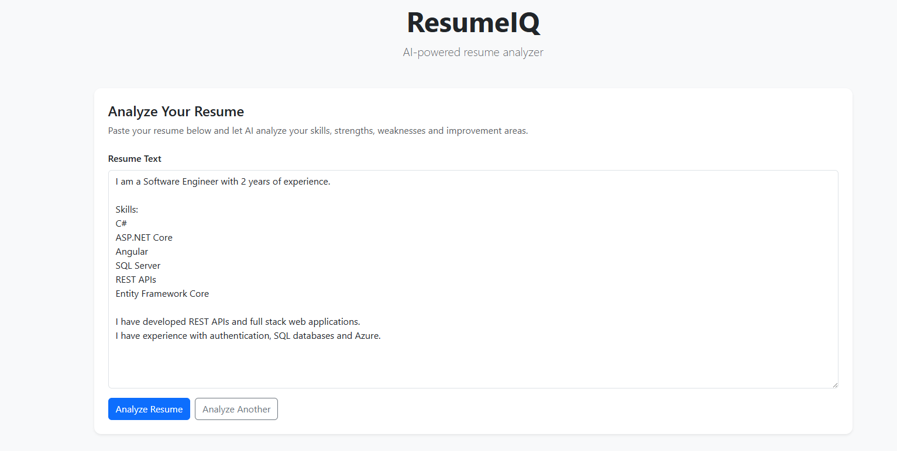
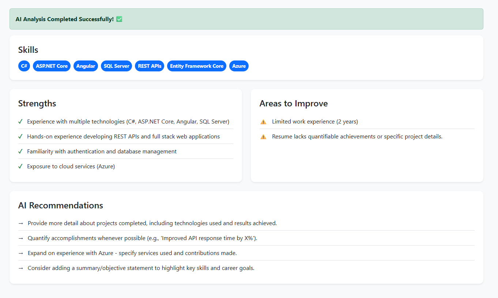
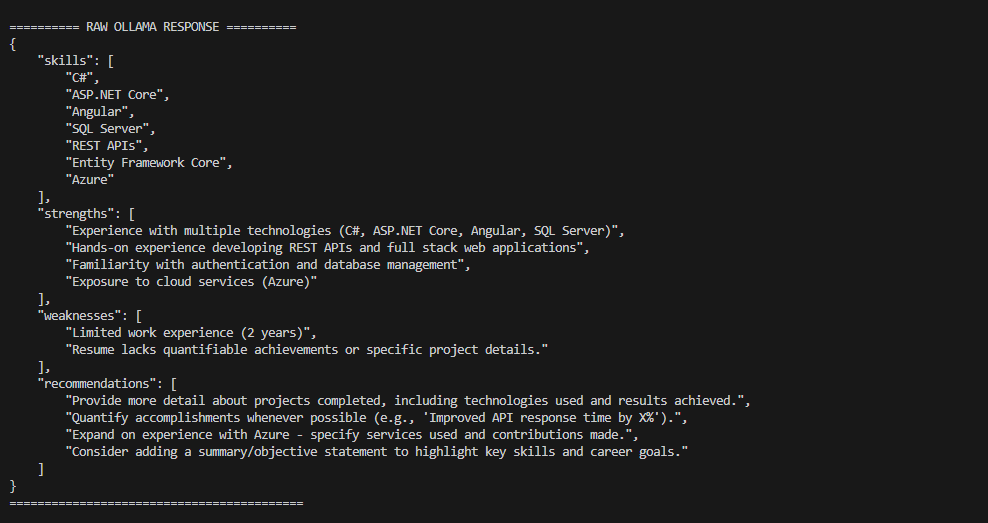

# 🚀 CareerIQ — AI-Powered Resume Analyzer

CareerIQ is a full-stack AI-powered resume analysis application built using **Angular**, **ASP.NET Core Web API**, and a configurable AI provider[cite: 3]. Groq is the default analysis provider; local **Gemma 3** through **Ollama** remains available[cite: 3].

The application analyzes resume content and generates structured insights including:

- 🛠️ Technical skills[cite: 3]
- 💪 Strengths[cite: 3]
- ⚠️ Areas for improvement[cite: 3]
- 💡 AI-generated recommendations[cite: 3]

The project demonstrates integrating AI/LLM capabilities into a full-stack application, with the option to use either a hosted provider or local inference[cite: 3].

**Default setup:** Groq handles resume analysis and requires an API key[cite: 3]. Ollama is optional for local inference or local RAG embeddings[cite: 3]. RAG is disabled by default[cite: 3].

---

## ✨ Features

- 🤖 AI-powered resume analysis[cite: 3]
- ⚡ Groq-hosted resume analysis by default[cite: 3]
- 🧠 Optional local LLM inference using Gemma 3 and Ollama[cite: 3]
- 🔌 ASP.NET Core REST API[cite: 3]
- 🅰️ Angular frontend[cite: 3]
- 🎨 Responsive CareerIQ UI[cite: 3]
- 🎯 SCSS styling[cite: 3]
- 📦 Structured JSON AI responses[cite: 3]
- 💉 Dependency Injection[cite: 3]
- 🔄 HttpClientFactory[cite: 3]
- 🧩 AI service abstraction using `IAiService`[cite: 3]
- 📋 Automatic skill extraction[cite: 3]
- 💪 Strength identification[cite: 3]
- ⚠️ Weakness detection[cite: 3]
- 💡 AI-generated recommendations[cite: 3]
- 📖 Swagger/OpenAPI documentation[cite: 3]
- 🔐 CORS configuration[cite: 3]
- ⏳ Loading and error states[cite: 3]
- 📄 Resume file uploads for PDF, DOCX, legacy DOC, and CSV[cite: 3]
- 🔎 Server-side file signature validation and text extraction (10 MB maximum)[cite: 3]
- 🔐 Configurable local and hosted AI providers[cite: 3]

---

## 🎬 How It Works

1. Select a PDF, DOCX, legacy DOC, or CSV resume, or paste resume text[cite: 3].
2. Angular validates the selected input and sends it to the ASP.NET Core API[cite: 3].
3. For file uploads, the API validates the file again and extracts its text in memory[cite: 3].
4. If enabled, local RAG retrieves relevant passages from the Markdown knowledge base using Ollama embeddings[cite: 3].
5. The selected AI provider analyzes the resume: Groq by default, or local Ollama/Gemma 3[cite: 3].
6. The API returns the existing structured response and Angular displays the actual analysis[cite: 3].

The uploaded file is not permanently stored[cite: 3]. With the default Groq provider, extracted resume text is sent to Groq; with Ollama selected, analysis runs locally[cite: 3]. Enabling RAG uses Ollama locally for embeddings but does not make Groq analysis local[cite: 3].

---

## 📸 Screenshots

### 📝 Resume Analyzer

The Angular frontend provides the responsive CareerIQ analyzer, with resume file upload and a paste-text fallback[cite: 3].



---

### 🤖 AI Resume Analysis

After the analysis is completed, CareerIQ displays detected skills, strengths, areas for improvement, and AI-generated recommendations[cite: 3].



---

### 🧠 Local Gemma 3 Response (Optional Provider)

This screenshot shows the optional local Ollama/Gemma 3 provider[cite: 3]. Groq is the configured default[cite: 3].



---

## 🏗️ Architecture

```text
Browser
  │
  ▼
Angular CareerIQ UI (localhost:4200)
  │
  ├── POST /api/Resume/analyze       JSON: { resumeText }
  └── POST /api/Resume/analyze-file  multipart/form-data: file
                                      │
                                      ▼
                         ASP.NET Core API (localhost:5155)
                                      │
                          ResumeController
                                      │
                   ┌──────────────────┴──────────────────┐
                   │ file upload?                        │
                   ▼                                     │
       Validate size/type/signature                     │
                   │                                     │
       Extract PDF/DOCX/DOC/CSV text                    │
                   └──────────────────┬──────────────────┘
                                      ▼
                                   IAiService
                                      │
                          Optional local RAG context
                                      │
                       ┌──────────────┴──────────────┐
                       ▼                             ▼
             GroqAiService (default)       OllamaAiService (optional)
                       │                             │
             Groq Chat Completions          Ollama → Gemma 3
                       └──────────────┬──────────────┘
                                      ▼
                         ResumeAnalysisResponse JSON
                                      │
                                      ▼
                     Angular results cards and skills

```

### Optional local RAG data flow

```text
Resume text ───────────────┐
                           ▼
Markdown guidance ──→ Ollama embedding model
                           │
                   cosine-similarity search
                           │
                   top matching passages
                           │
                           ▼
              Selected AI provider prompt
                           │
             ┌─────────────┴─────────────┐
             ▼                           ▼
        Groq API                    Local Ollama
    (resume is sent)                 (Gemma 3)

```

RAG is disabled by default. When enabled with Groq, Ollama performs local embeddings/retrieval, but Groq still receives the resume text and retrieved guidance for analysis.

---

## 🔄 End-to-End Request Flow

```text
Text input:
Angular → POST /api/Resume/analyze { resumeText } ─────────────┐
                                                               │
File input:                                                    │
Angular → POST /api/Resume/analyze-file (multipart file)       │
                 │                                             │
                 ▼                                             │
         validate and extract text                             │
                 └──────────────────────┬──────────────────────┘
                                        ▼
                              ResumeController
                                        │
                              optional local RAG
                                        │
                              selected IAiService
                                        │
                        Groq (default) or Ollama
                                        │
                          structured JSON response
                                        │
                                        ▼
                         Angular renders results

```

---

## 🛠️ Technology Stack

### Frontend

* Angular


* TypeScript


* SCSS


* RxJS


* Angular HttpClient


* Angular Signals


### Backend

* ASP.NET Core Web API


* C#


* .NET 8 / .NET 9


* REST APIs


* Dependency Injection


* HttpClientFactory


* DTOs


* Swagger / OpenAPI


* CORS


* PdfPig (Apache-2.0) for PDF text extraction


* Open XML SDK (MIT) for DOCX text extraction


* NPOI.HWPFCore (Apache-2.0) for legacy DOC text extraction


* .NET `TextFieldParser` for quoted CSV parsing


### AI & Retrieval

* Groq Chat Completions API (default; `openai/gpt-oss-20b`)


* Optional Ollama local inference (`gemma3`)


* Optional Ollama embeddings (`nomic-embed-text`) for local RAG


* Local Markdown knowledge base and in-memory cosine-similarity search


* Prompt Engineering


* Structured JSON Schema response


---

## 📁 Project Structure

```text
CareerI/
├── backend/
│   ├── CareerIQ.API/
│   │   ├── Controllers/
│   │   │   └── ResumeController.cs
│   │   ├── KnowledgeBase/
│   │   │   └── resume-guidance.md
│   │   ├── Models/
│   │   │   ├── ResumeAnalysisRequest.cs
│   │   │   └── ResumeAnalysisResponse.cs
│   │   ├── Properties/
│   │   │   └── launchSettings.json
│   │   ├── Services/
│   │   │   ├── IAiService.cs
│   │   │   ├── GroqAiService.cs
│   │   │   ├── OllamaAiService.cs
│   │   │   ├── IRagContextService.cs
│   │   │   ├── OllamaRagContextService.cs
│   │   │   ├── ResumeAnalysisPrompt.cs
│   │   │   ├── ResumeAnalysisResponseParser.cs
│   │   │   └── ResumeDocumentExtractor.cs
│   │   ├── appsettings.Development.json
│   │   ├── appsettings.json
│   │   ├── CareerIQ.API.csproj
│   │   ├── CareerIQ.API.http
│   │   └── Program.cs
│   │
│   └── CareerIQ.API.Tests/
│       ├── GroqAiServiceTests.cs
│       ├── OllamaRagContextServiceTests.cs
│       ├── ResumeDocumentExtractorTests.cs
│       ├── Usings.cs
│       └── CareerIQ.API.Tests.csproj
│
├── frontend/
│   ├── public/
│   │   └── favicon.ico
│   ├── src/
│   │   ├── app/
│   │   │   ├── core/
│   │   │   │   ├── models/
│   │   │   │   │   ├── resume-analysis.model.ts
│   │   │   │   │   └── resume-analysis-request.model.ts
│   │   │   │   └── services/
│   │   │   │       ├── resume.ts
│   │   │   │       └── resume.spec.ts
│   │   │   └── features/
│   │   │       └── resume-analyzer/
│   │   │           ├── resume-analyzer.html
│   │   │           ├── resume-analyzer.scss
│   │   │           ├── resume-analyzer.spec.ts
│   │   │           └── resume-analyzer.ts
│   │   ├── index.html
│   │   ├── main.server.ts
│   │   ├── main.ts
│   │   ├── server.ts
│   │   └── styles.scss
│   ├── angular.json
│   ├── package.json
│   ├── package-lock.json
│   ├── tsconfig.app.json
│   ├── tsconfig.json
│   └── tsconfig.spec.json
│
├── docs/
│   └── screenshots/
│       ├── ai-analysis-results.png
│       ├── ollama-response.png
│       └── resume-analyzer.png
│
├── .gitignore
├── CareerIQ.sln
└── Readme.md

```

---

## 🤖 AI Integration

CareerIQ supports two analysis providers. **Groq is the default** and runs the `openai/gpt-oss-20b` model through Groq's hosted API. **Ollama is optional** for local inference with Gemma 3. Choose the provider using `Ai:Provider` in `backend/CareerIQ.API/appsettings.json`.

```text
ASP.NET Core
  │
  ├── Ai:Provider = Groq (default)
  │      └── Groq Chat Completions API → JSON analysis
  │
  └── Ai:Provider = Ollama
         └── Ollama API → Gemma 3 → JSON analysis

```

For Groq, the backend sends extracted resume text to Groq for analysis. For Ollama, inference runs locally. Uploaded resume files are not permanently stored by the API.

---

## 🔌 API Reference

Both endpoints return the same response contract:

```json
{
  "skills": ["ASP.NET Core", "Angular", "C#", "SQL Server"],
  "strengths": ["Strong backend and API architecture experience"],
  "weaknesses": ["Limited quantified production metrics"],
  "recommendations": ["Add measurable metrics and system throughput achievements"]
}

```

### Analyze Resume Text

```http
POST /api/Resume/analyze
Content-Type: application/json

{
  "resumeText": "Experienced software developer skilled in building REST APIs with ASP.NET Core and Angular."
}

```

### Analyze Resume File

```http
POST /api/Resume/analyze-file
Content-Type: multipart/form-data

```

Send the resume in the `file` form field. PDF, DOCX, legacy DOC, and CSV files are supported up to 10 MB. Text extraction runs entirely in-memory and files are discarded immediately after processing.

---

## ⚙️ AI Configuration & Secrets

The backend uses Groq by default.

Example configuration in `backend/CareerIQ.API/appsettings.json`:

```json
{
  "Ai": {
    "Provider": "Groq"
  },
  "Groq": {
    "BaseUrl": "[https://api.groq.com](https://api.groq.com)",
    "Model": "openai/gpt-oss-20b"
  },
  "Ollama": {
    "BaseUrl": "http://localhost:11434",
    "Model": "gemma3"
  },
  "Rag": {
    "Enabled": false,
    "EmbeddingModel": "nomic-embed-text",
    "TopK": 3
  }
}

```

### Setting the Groq API Key

1. Create a `.env` file inside `backend/CareerIQ.API/` (copy from `.env.example` if available).
2. Add your key:
```env
GROQ_API_KEY=gsk_your_actual_key_here

```


3. Alternatively, export it as an environment variable:
```bash
export Groq__ApiKey="gsk_your_actual_key_here"

```


---

## 💻 Local Quickstart

### 1. Prerequisites

* [.NET 8+ SDK](https://dotnet.microsoft.com/download)
* [Node.js (v20+)](https://nodejs.org/) & npm
* [Angular CLI](https://angular.dev/) (`npm install -g @angular/cli`)

### 2. Backend Setup

From the repository root:

```bash
cd backend/CareerIQ.API
dotnet restore
dotnet build
dotnet run

```

The API starts at `http://localhost:5155`. Interactive Swagger docs are available at `http://localhost:5155/swagger`.

To run the backend test suite:

```bash
# Run from repository root
dotnet test backend/CareerIQ.API.Tests/CareerIQ.API.Tests.csproj

```

### 3. Frontend Setup

In a new terminal, navigate to the frontend directory:

```bash
cd frontend
npm install
npm run start

```

Open `http://localhost:4200` in your browser.

---

## 🦙 Optional Local Ollama & RAG Setup

If you prefer completely local, offline execution without Groq:

1. Install [Ollama](https://ollama.com/).


2. Pull Gemma 3 and the embedding model:


```bash
ollama pull gemma3
ollama pull nomic-embed-text

```


3. In `backend/CareerIQ.API/appsettings.json`, set:
```json
"Ai": {
  "Provider": "Ollama"
},
"Rag": {
  "Enabled": true
}

```


---

## 👨‍💻 Author

**Tejas Rastogi**

* **GitHub:** [@tejasrastogileet](https://github.com/tejasrastogileet)
* **LinkedIn:** [Tejas Rastogi](https://linkedin.com/in/tejas-rastogi-292b81231)
* **Email:** tejasrastogi456@gmail.com


---

## 📄 License

This project is licensed under the MIT License — free for educational and demonstration purposes.

```
